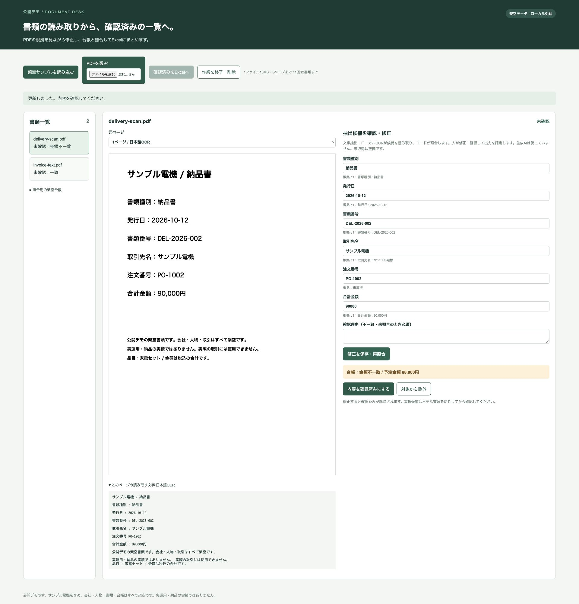
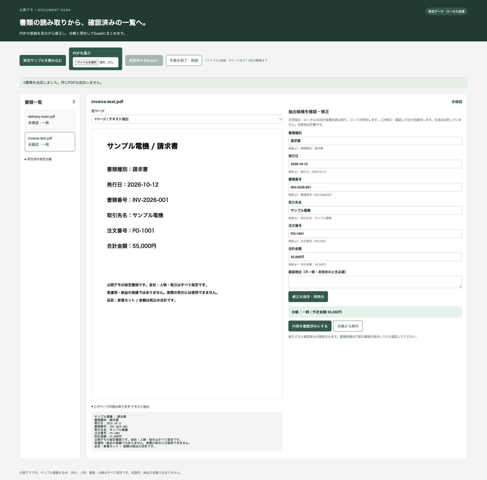

# サンプル電機の書類照合デモ

日本語の請求書・納品書PDFを読み取り、元ページと読み取り文字を見ながら修正し、台帳との照合結果をExcelへ出力する、公開デモです。サンプル電機を含む会社・人物・書類・取引・金額はすべて架空です。実運用・納品の実績ではありません。





## 起動

Python 3.11以上と、Tesseract 5系・日本語/英語の言語データが必要です。このディレクトリだけで起動でき、DBやAPIキーは使いません。ブラウザー以外に外部サービスへの通信を実装していません。依存の導入時はパッケージ配布元へ接続します。

macOSでOCRが未導入の場合（導入は利用者が行ってください）：

```sh
brew install tesseract tesseract-lang
```

Ubuntu / Debianの場合：

```sh
sudo apt install tesseract-ocr tesseract-ocr-jpn tesseract-ocr-eng
```

```sh
tesseract --version
tesseract --list-langs
```

`jpn`と`eng`が一覧にあり、`tesseract`がPATHにあることを確認してください。Windowsでの動作は未確認です。

このディレクトリを開いて、専用環境を作成します。

```sh
python3 -m venv .venv
.venv/bin/python -m pip install -r requirements.txt
.venv/bin/python app.py
```

Chromeなどで `http://127.0.0.1:5055` を開きます。停止はターミナルでCtrl-Cです。ポート5055が使用中なら、既存の処理を確認し、別の処理を無断で停止しないでください。公開サーバーへの配置を想定していません。

## 操作

1. 「架空サンプルを読み込む」を押すか、「PDFを選ぶ」でローカルPDFを1件ずつ追加します。
2. 左の一覧から書類を選び、ページ画像と読み取り文字、各項目の根拠ページを見比べます。
3. 候補を修正し、「修正を保存・再照合」を押します。
4. 台帳との照合結果を確認します。不一致・未照合を残す場合は理由を入力して保存します。
5. 「内容を確認済みにする」を押します。確認済みの書類だけを「確認済みをExcelへ」でダウンロードできます。
6. 終了時は「作業を終了・削除」を押し、不要なダウンロードファイルも利用者側で削除してください。

同梱サンプル：

| ファイル | 読み取り方式 | 内容 |
| --- | --- | --- |
| `samples/invoice-text.pdf` | テキスト抽出 | 請求書。PO-1001、55,000円で台帳と一致 |
| `samples/delivery-scan.pdf` | 実際の日本語OCR | 納品書。PO-1002、90,000円で台帳88,000円と不一致 |
| `samples/ledger.csv` | 確定ルールの照合元 | 取引先・注文番号・予定金額の架空台帳 |

今回のmacOS・Tesseract 5系で、同梱の文字PDFの抽出と画像PDFの日本語OCR、修正・再照合・確認解除・Excelの日付型と数値型を確認しました。精度や時間短縮効果は測定していません。

OCRはカンマをピリオドに誤読したり、項目名の後の区切りを落としたりすることがあります。今回の画像PDFでは注文番号が未取得となりました。元ページの`PO-1002`を確認して入力してください。例えば`90.000円`は無効な金額として止めます。元ページの`90,000円`を確認し、`90000`へ修正してください。推測で桁区切りを直したり、未取得の値を埋めたりしません。

不一致理由の例：「架空サンプルの追加費用2,000円を確認。台帳との差額を残して出力。」これは操作説明のための架空の理由です。

## OCR・コード・人の役割

生成AIは使用していません。文字抽出とローカルOCRで候補を取得します。

- PDFiumがページ表示と文字抽出を行います。抽出文字がないページは、そのページを画像化してローカルTesseractでOCRします。候補は`項目名：値`の行から取り、ファイル名を使った固定応答はありません。
- コードが日付・金額の変換、必須項目、重複、台帳照合を判定します。台帳は取引先と注文番号で照合し、候補が0件または複数なら未照合です。
- 人が根拠と候補を確認して出力対象を確定します。修正の保存・対象除外の変更で確認済みが解除されます。保存前の編集がある間はExcel出力と確認を止めます。

同じPDFの再読込は内容のハッシュで追加を防ぎます。別ファイルでも、書類種別・取引先名・書類番号が同じなら重複候補です。空欄、無効な日付・金額、未解決の重複は出力できません。不要な書類を除外してから残す書類を再確認してください。請求書と納品書は別種別で、注文番号だけでは重複と判定しません。

Excelは抽出6項目、元ファイル名、項目別の根拠ページ、照合状態、確認理由を持ちます。発行日は日付、金額は数値で書き、元書類や入力に由来する文字は数式として評価されない文字列で出力します。未確認・除外・重複の書類は含みません。

## 対象と制限

- 初版は同梱した日本語請求書・納品書の形式（各1種類）に対応します。1つのPDFは1書類です。複数ページでは各項目について最初に見つけた行を候補にします。1つのPDFに複数の請求書が入ったものは分割してから読み込んでください。
- 1ファイル10MB・5ページ、ページサイズA3相当まで、1回12書類まで。OCRは1ページ45秒で打ち切ります。同時に処理せず順に読み取ります。
- 日付は`YYYY-MM-DD`、金額は0以上の整数・12桁以内（カンマ区切り、末尾の「円」は可）。任意レイアウト、手書き、複雑な明細、縦書き、暗号化PDFは対象外です。
- 文字層が一部だけ存在するPDFは文字抽出を優先します。画像部分のみの文字の追加OCRは行いません。候補欠落は人が元画像で確認してください。
- 書類・ページ画像・編集内容はプロセスのメモリ内だけで扱い、履歴や本文ログを保存しません。画面ごとに作業を分けます。再読み込みで新しい作業になります。操作が30分ない作業は次のリクエスト時に削除します。確実に消去するには「作業を終了・削除」またはサーバー停止を使ってください。
- 同時作業は8画面まで。再読み込み後の作業復元はありません。単独のローカル利用向けで、認証・共同編集・恒久保存は提供しません。
- OCR結果や照合一致は、書類の正当性・業務上の承認を保証しません。出力前に元ページを確認してください。

## 使用OSS・参考にした出発点

他の業務アプリやテンプレートをコピーせず、以下の公式APIの基本例を出発点として実装しました。依存は各配布元から導入します。依存バイナリーやフォントはこのディレクトリに同梱していません。依存を再配布する場合は各著作権表示・ライセンス本文を保持してください。

| OSS | 用途・ライセンス | 公式資料 |
| --- | --- | --- |
| Flask / Werkzeug / Jinja2 / MarkupSafe / Click / ItsDangerous | ローカルWeb、BSD-3-Clause | [Flask](https://flask.palletsprojects.com/)、[ソースとライセンス](https://github.com/pallets/flask) |
| Blinker 1.9.0 | Webアプリのシグナル、MIT | 配布物の`blinker-1.9.0.dist-info/LICENSE.txt` |
| pypdfium2 4.30.0 | PDF表示・抽出、Apache-2.0またはBSD-3-Clause。PDFiumはBSD系と第三者ライセンスを含む | [API・ライセンス案内](https://pypdfium2.readthedocs.io/)、配布物の`LicenseRef-PdfiumThirdParty.txt` |
| Tesseract / tessdata | 日本語OCR、Apache-2.0 | [Tesseract](https://github.com/tesseract-ocr/tesseract)、[言語データ](https://github.com/tesseract-ocr/tessdata) |
| Pillow 11.3.0 | ページ画像のPNG化、MIT-CMU。配布物には第三者ライブラリーの表示も含む | [ライセンス](https://github.com/python-pillow/Pillow/blob/main/LICENSE) |
| openpyxl 3.1.5 / et_xmlfile | Excel生成、MIT | [openpyxl](https://openpyxl.readthedocs.io/)、[et_xmlfile](https://et-xmlfile.readthedocs.io/) |
| ReportLab 4.4.4 | 同梱PDF作成時のみ、BSD | [ReportLab](https://www.reportlab.com/opensource/) |

同梱PDFはReportLabの日本語CIDフォント指定で作成し、画像PDFはそのページをPDFiumでラスタライズしたものです。フォントファイルは埋め込み・同梱していません。実行時にReportLabは不要です。
